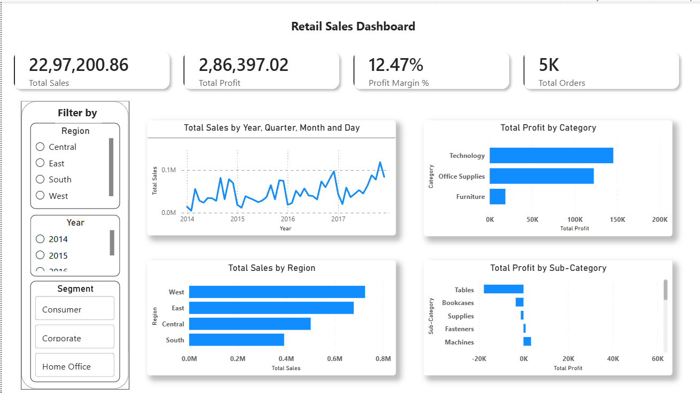

# Retail Sales Analysis (Python + Power BI)

An end-to-end data analysis project on the Superstore sales dataset. I cleaned and analyzed the data in Python, found where the business makes and loses money, and built an interactive Power BI dashboard with DAX measures.



## Objective

Find out which regions, categories and customers drive profit, where the business loses money, and how discounts affect profitability.

## Business Questions

1. Which regions and categories generate the most sales and profit?
2. Which sub-categories are loss-making?
3. How do sales change month by month, and is there seasonality?
4. How do discounts affect profit?
5. Who are the top customers, and how dependent is the business on them?

## Tools Used

| Area | Tools |
|---|---|
| Data cleaning and analysis | Python, Pandas, NumPy |
| Visualization | Matplotlib, Seaborn |
| Dashboard | Power BI Desktop, DAX |
| Environment | Jupyter Notebook, VS Code |
| Version control | Git, GitHub |

## Dataset

Superstore sales dataset from Kaggle: about 10,000 order lines from 2014 to 2017, with sales, profit, discount, quantity, region, category, sub-category, segment and customer details.

## Key Results

| Metric | Value |
|---|---|
| Total Sales | 2,297,200.86 |
| Total Profit | 286,397.02 |
| Profit Margin | 12.47% |

## Key Insights

1. **Region:** The West region earned the highest profit (108,418) with a 14.9% margin. Central earned the lowest profit (39,706) with only a 7.9% margin, even though its sales are higher than the South's.
2. **Category:** Technology (145,455) and Office Supplies (122,491) generate most of the profit. Furniture has similar sales (741,999) but only 18,451 profit, a 2.5% margin, compared with about 17% for the other two categories.
3. **Loss-making sub-categories:** Tables lost 17,725, Bookcases lost 3,473 and Supplies lost 1,189. Tables is the biggest loss-maker and explains much of Furniture's weak profit.
4. **Discounts:** Average profit per order line falls as discounts rise: +66.90 with no discount, +26.50 at 1-20%, -77.86 at 21-40%, and -106.71 above 40%. Orders discounted above 40% lost about 99,559 in total.
5. **Seasonality:** Sales peak in November (352,461), December (325,294) and September (307,650), which points to a strong end-of-year season.
6. **Customers:** The top 10 customers contributed only about 6.7% of total sales, so revenue is spread widely and the business does not depend on a few big customers.

## Recommendations

- Cap discounts at around 20%, because deeper discounts lead to negative average profit.
- Review pricing and discount policy for Tables, Bookcases and the wider Furniture category.
- Investigate why the Central region has a much lower margin than the West and East.
- Plan inventory and marketing ahead of the November to December peak.

## Dashboard

The Power BI dashboard includes:

- **KPI cards:** Total Sales, Total Profit, Profit Margin %, Total Orders
- **Charts:** monthly sales trend, profit by category, profit by sub-category, sales by region
- **Slicers:** Region, Year, Segment
- **DAX measures:** Total Sales, Total Profit, Profit Margin % (calculated with `DIVIDE`, total profit divided by total sales), Total Orders (`DISTINCTCOUNT`), plus a calendar table for time analysis

Profit Margin % is a measure and not an average of a margin column, because averaging row-level margins gives a wrong overall figure.

The dashboard totals match the Python results above, which I used to validate the data load.

## Project Structure

```
retail-sales-analysis/
├── data/
│   ├── raw/                              # original dataset 
│   └── processed/                        # cleaned dataset
├── notebooks/
│   ├── 01_data_cleaning.ipynb            # cleaning and feature creation
│   └── 02_analysis_and_visualization.ipynb   # analysis, charts, insights
├── images/                               # charts and dashboard screenshot
├── powerbi/
│   └── retail_dashboard.pbix             # Power BI dashboard
├── README.md
└── requirements.txt
```

## How to Run

1. Clone the repository:
   ```
   git clone https://github.com/NiwashKumarMandal/retail-sales-analysis.git
   cd retail-sales-analysis
   ```
2. Install the libraries:
   ```
   pip install -r requirements.txt
   ```
3. Download the Superstore dataset from Kaggle, rename it to `superstore.csv`, and place it in `data/raw/`.
4. Run `notebooks/01_data_cleaning.ipynb`, then `notebooks/02_analysis_and_visualization.ipynb`.
5. Open `powerbi/retail_dashboard.pbix` in Power BI Desktop (Windows) to explore the dashboard.

## What I Learned

- Cleaning data and creating new features (year, month, shipping days) with Pandas.
- Turning business questions into grouped analysis and clear charts.
- Building a date table, relationships and DAX measures in Power BI.
- Validating a dashboard by matching its totals against Python results.
